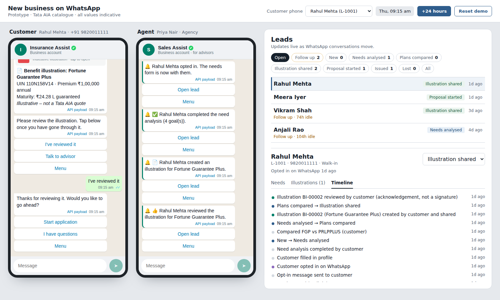

# New business on WhatsApp — prototype

Advisor-assisted and self-serve new-business journeys over WhatsApp, covering four modules: need analysis, product comparison, lead tracking and benefit illustration sharing. The catalogue is Tata AIA's online plans (exact UINs), and **every premium and benefit value is an indicative placeholder**.



## Run it

```bash
npm install
npm run dev          # API on :4000, web on :5173
npm test             # unit + journey tests
```

Open http://localhost:5173. Requires Node 20+.

## Demo script (5 minutes)

1. **Agent phone:** send `Hi`, choose **My leads**, open **Rahul Mehta** and choose **Send needs form**. Rahul hasn't opted in, so the opt-in template goes out first.
2. **Customer phone** (Rahul selected at the top): tap **Yes, continue**, fill in **About you**, then **Your goals**. The agent gets a notification and the dashboard moves the lead to *Needs analysed*.
3. Customer: **See my plans**, pick a plan, **Compare**, pick another. The lead moves to *Plans compared*.
4. Customer: **Illustrate plan 1**, set details, and a watermarked PDF arrives as a WhatsApp document. Tap **I've reviewed it**, then **Start application**. The lead moves to *Proposal started*.
5. Click **+24 hours** a few times to see follow-up flags and the 24-hour session window. Messages outside it are marked as templates.
6. On any bot message, click **API payload** to see the exact WhatsApp Cloud API JSON.

The agent can do everything on a customer's behalf too: fill the needs form, compare, create an illustration, check it, then **Share with customer**.

## Repo map

| Path | What |
|---|---|
| `packages/shared` | Pure JS used by both apps: catalogue (`products.js`), need analysis (`needs.js`), illustration engine (`illustration.js`), pipeline rules (`leads.js`), Cloud API adapter (`whatsapp.js`), bots (`bots/`) |
| `apps/mock-api` | Express: REST + SSE, in-memory store with seed data, PDF renderer, Cloud API webhook shape |
| `apps/web` | Vite + React: two simulated phones and the lead dashboard |
| `docs/` | `PRD.md`, `openapi.yaml`, `CLAUDE.md` (Claude Code handoff and backlog) |

## What is real and what is placeholder

| Real | Placeholder |
|---|---|
| Plan names, UINs, categories, regulatory descriptions (tataaia.com, 2026-09-30) | All premiums, benefits, IRRs, fund values, annuity rates |
| WhatsApp message types, limits, template and 24h-window behaviour | Eligibility ranges |
| Stage model, consent gate, audit timeline | Need analysis assumptions (tunable in `NEED_ASSUMPTIONS`) |
